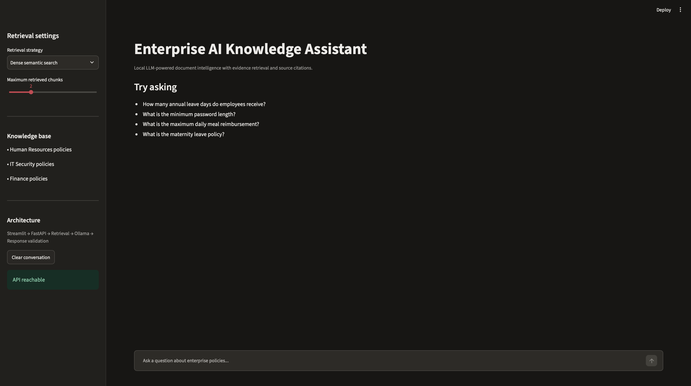
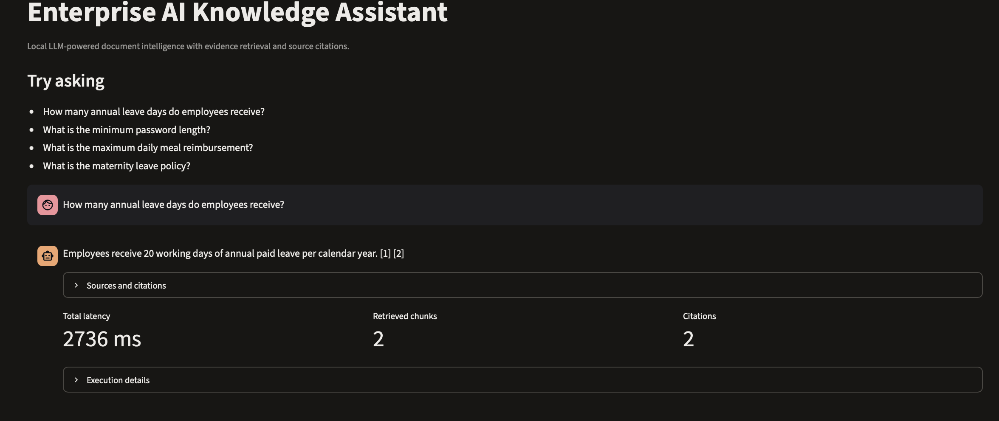
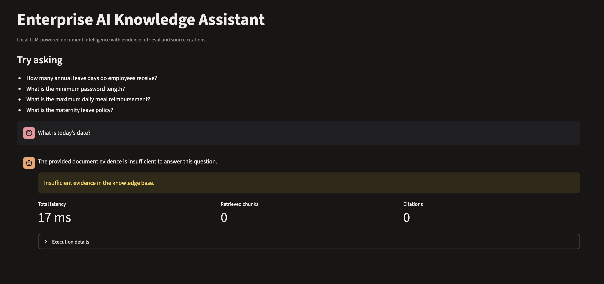
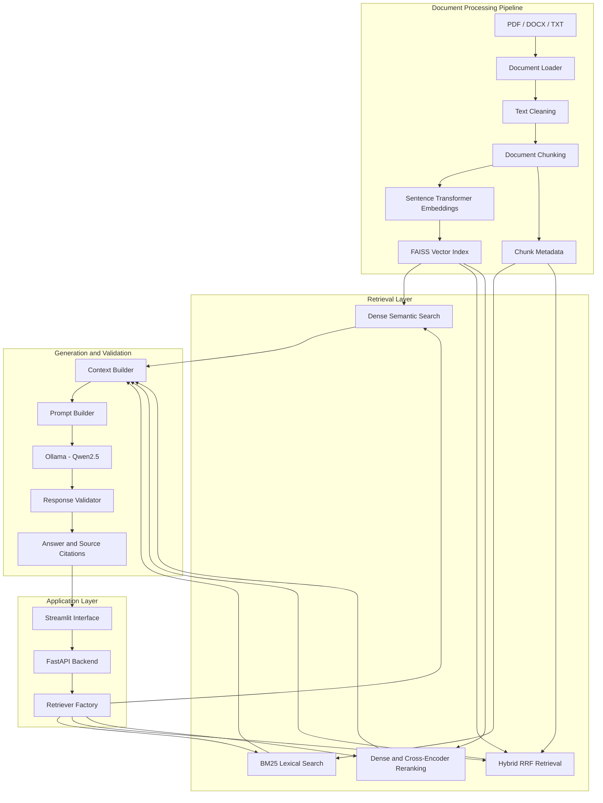

# Enterprise AI Knowledge Assistant

**An end-to-end Retrieval-Augmented Generation (RAG) system for enterprise document intelligence, featuring configurable retrieval pipelines, local LLM inference, automated evaluation, REST APIs and an interactive user interface.**


## Project Overview

Enterprise organizations maintain large volumes of unstructured information across policy documents, operational guidelines and internal knowledge repositories. Traditional keyword-based search often struggles to retrieve relevant information and provide contextual answers.

The Enterprise AI Knowledge Assistant addresses this challenge through a modular Retrieval-Augmented Generation architecture that enables users to query enterprise documents using natural language and receive contextual answers with traceable source citations.

The system combines semantic search, lexical retrieval, reciprocal rank fusion, cross-encoder reranking and local language model inference. It also incorporates automated evaluation frameworks to measure retrieval quality, generation performance, latency and insufficient-evidence handling.

The project demonstrates the complete development lifecycle of an applied AI system, from document ingestion and experimentation to API serving and application development.

## Application Demo

### Interactive Knowledge Assistant



### Contextual Answers with Source Citations



### Insufficient-Evidence Handling



## Key Results

| Performance Indicator | Result |
|---|---:|
| Calibration retrieval Recall@2 | 100% |
| Best Mean Reciprocal Rank | 1.0000 |
| Dense retrieval p95 latency | 3.70 ms |
| Calibrated reranked retrieval p95 latency | 20.42 ms |
| Retrieval configurations benchmarked | 7 |
| Measured retrieval benchmark requests | 1,260 |
| Calibration evaluation queries | 18 |
| Previously verified passing tests | 663+ |
| Supported retrieval strategies | 4 |

All benchmark results were obtained using a small synthetic enterprise-policy corpus. They represent controlled experimental results rather than production-scale performance guarantees.

## Key Features

### Document Intelligence

- PDF, DOCX and TXT document ingestion.
- Text cleaning and normalization.
- Overlapping document chunking.
- Document metadata and source tracking.
- SHA-256 artifact integrity verification.
- Persistent vector indexes and chunk metadata.

### Advanced Information Retrieval

- Dense semantic retrieval using Sentence Transformers and FAISS.
- Sparse lexical retrieval using BM25.
- Hybrid retrieval using Reciprocal Rank Fusion.
- Cross-encoder reranking using MS MARCO MiniLM.
- Configurable retrieval strategies and candidate selection.
- Strategy-specific relevance thresholds.
- Deterministic ranking and retrieval benchmarking.

### Generative AI

- Local language model inference using Ollama.
- Qwen2.5:1.5B language model.
- Context construction with configurable character budgets.
- Structured JSON answer generation.
- Prompt versioning and comparative experimentation.
- Source citation validation.
- Insufficient-evidence abstention.
- Experimental evidence and grounding verification.

### Application Engineering

- FastAPI REST backend.
- Interactive Streamlit frontend.
- Configurable retrieval settings.
- Source citations and document metadata.
- Response latency and retrieval metrics.
- Interactive Swagger API documentation.
- Backend connectivity checks.
- Structured error handling.

## System Architecture



## Technology Stack

| Component | Technology |
|---|---|
| Programming language | Python 3.11 |
| Deep learning | PyTorch |
| Embedding framework | Sentence Transformers |
| Embedding model | all-MiniLM-L6-v2 |
| Embedding dimensions | 384 |
| Vector database | FAISS |
| Vector index | IndexFlatIP |
| Similarity metric | Cosine similarity |
| Lexical retrieval | BM25 |
| Hybrid retrieval | Reciprocal Rank Fusion |
| Reranking model | cross-encoder/ms-marco-MiniLM-L-6-v2 |
| Language model | Qwen2.5:1.5B |
| LLM inference | Ollama |
| Document processing | PyMuPDF, python-docx |
| Backend | FastAPI, Uvicorn |
| Frontend | Streamlit |
| Testing | Pytest |
| Code quality | Ruff |
| Version control | Git, GitHub |

## Retrieval Strategies

The application supports four configurable retrieval strategies.

| Strategy | Description | Score Type |
|---|---|---|
| Dense | Semantic similarity between query and document embeddings | Cosine similarity |
| BM25 | Traditional lexical relevance scoring | BM25 score |
| Hybrid | Combines dense and sparse rankings using RRF | RRF score |
| Dense Reranked | Dense candidate retrieval followed by cross-encoder reranking | Cross-encoder logit |

Dense retrieval is the default strategy because it provides a favorable balance between retrieval quality, computational cost and latency.

Cross-encoder reranking is available as an optional strategy for applications requiring improved relevance ordering.

Retrieval scores are strategy-specific and are not interpreted as interchangeable confidence probabilities.

## Experimental Evaluation

### Retrieval Performance

Seven retrieval configurations were benchmarked using 18 calibration queries, including 14 answerable questions and four unsupported questions.

Each configuration was evaluated using repeated inference requests, warm-up runs, ranking metrics and latency measurements.

| Retrieval Configuration | Recall@2 | MRR | False Acceptance Rate | p95 Latency |
|---|---:|---:|---:|---:|
| Dense baseline | 100% | 0.9643 | 50% | 3.70 ms |
| BM25 baseline | 100% | 1.0000 | 100% | 0.07 ms |
| Hybrid baseline | 100% | 1.0000 | 100% | 3.70 ms |
| Dense reranked — unfiltered | 100% | 1.0000 | 50% | 21.33 ms |
| Dense reranked — calibrated | 100% | 1.0000 | 50% | 20.42 ms |
| Expanded dense reranked | 100% | 1.0000 | 50% | 41.56 ms |
| Hybrid reranked | 100% | 1.0000 | 50% | 31.06 ms |

### Mean Reciprocal Rank Improvement

Cross-encoder reranking improved MRR from 0.9643 to 1.0000, representing approximately a 3.70% relative improvement over the dense baseline.

### Candidate Selection Optimization

Compared with expanded dense reranking, the calibrated dense reranking pipeline achieved:

- 71.11% fewer average reranking candidates.
- Approximately 64% lower mean retrieval latency.
- Approximately 51% lower p95 retrieval latency.
- Preserved 100% calibration retrieval recall.

### Key Experimental Findings

- Dense retrieval provides a strong latency-quality trade-off.
- BM25 offers extremely low retrieval latency but weaker unsupported-question rejection.
- Hybrid retrieval improves ranking performance but does not necessarily improve answerability detection.
- Cross-encoder reranking improves relevance ordering at additional computational cost.
- Relevance thresholds alone are insufficient for reliable unsupported-question detection.
- Candidate filtering significantly reduces reranking overhead.
- Retrieval quality does not automatically guarantee generation correctness.

These findings informed the decision to retain dense retrieval as the default strategy while exposing alternative retrieval pipelines for experimentation.

## Generation Evaluation

The generation evaluation framework measures answerability, citation quality, operational reliability, token consumption and response latency.

Two prompt versions were evaluated using the same 18-query calibration dataset.

| Metric | Prompt V1 | Prompt V2 |
|---|---:|---:|
| Answerability accuracy | 88.89% | 88.89% |
| Answerability F1 | 93.33% | 93.33% |
| Citation precision | 89.29% | 92.86% |
| Citation recall | 96.43% | 78.57% |
| Citation F1 | 90.48% | 83.33% |
| Total tokens | 7,792 | 13,808 |
| Mean end-to-end latency | 666.65 ms | 666.81 ms |

Prompt V1 was retained because it achieved stronger citation recall, higher citation F1 and lower token consumption.

Experimental evidence verification and grounding verification components were also developed and evaluated. They were not enabled as mandatory production gates because their measured reliability and false-rejection trade-offs did not justify default activation.

## Evaluation Methodology

The project includes automated evaluation infrastructure covering:

**Retrieval Quality**

- Precision@K
- Recall@K
- Mean Reciprocal Rank
- Hit Rate@K
- Complete Recall@K
- Returned-chunk precision
- False acceptance rate
- False rejection rate

**Generation Quality**

- Answerability accuracy
- Precision, recall and F1
- Citation precision and recall
- Structured response validity
- Insufficient-evidence handling
- Manual answer review

**System Performance**

- Mean, median and p95 latency
- Retrieval and generation latency
- Token consumption
- Candidate counts
- Ranking determinism

Detailed experimental reports are maintained under `docs/benchmarks/`.

## Project Structure

```text
enterprise-ai-knowledge-assistant/
│
├── app.py
├── pyproject.toml
├── README.md
│
├── src/
│   └── knowledge_assistant/
│       ├── api.py
│       ├── config.py
│       ├── models.py
│       ├── document_loader.py
│       ├── cleaning.py
│       ├── chunking.py
│       ├── pipeline.py
│       ├── embeddings.py
│       ├── vector_store.py
│       ├── indexing.py
│       ├── retrieval.py
│       ├── lexical_retrieval.py
│       ├── hybrid_retrieval.py
│       ├── rank_fusion.py
│       ├── reranking.py
│       ├── reranked_retrieval.py
│       ├── retrieval_interface.py
│       ├── retrieval_config.py
│       ├── retriever_factory.py
│       ├── prompts.py
│       ├── generation_schema.py
│       ├── llm.py
│       ├── rag.py
│       └── qa_cli.py
│
├── scripts/
│   ├── evaluate_generation.py
│   ├── benchmark_hybrid_retrieval.py
│   ├── benchmark_reranked_retrieval.py
│   └── calibrate_reranker.py
│
├── data/
│   ├── raw/
│   ├── processed/
│   └── evaluation/
│
├── artifacts/
│   ├── vector_index.faiss
│   ├── chunk_metadata.json
│   └── index_manifest.json
│
├── tests/
│   └── integration/
│
└── docs/
    ├── architecture.md
    ├── evaluation.md
    ├── benchmarks/
    └── screenshots/
```

The directory structure highlights the principal application modules and is not an exhaustive listing of every file.

## Installation

### Prerequisites

- Python 3.11
- Git
- Ollama
- macOS, Linux or a compatible Python environment

The project was developed and evaluated locally on an Apple Silicon Mac with 16 GB RAM.

### 1. Clone the repository

```bash
git clone https://github.com/Arshkaur1/enterprise-ai-knowledge-assistant.git

cd enterprise-ai-knowledge-assistant
```

### 2. Create a virtual environment

```bash
python3.11 -m venv .venv

source .venv/bin/activate
```

### 3. Install dependencies

```bash
python -m pip install --upgrade pip

python -m pip install -e ".[llm,documents,embeddings,retrieval,api,dev]"
```

### 4. Install the local language model

Install Ollama from https://ollama.com and download the model:

```bash
ollama pull qwen2.5:1.5b
```

### 5. Prepare retrieval artifacts

Place supported enterprise documents in `data/raw/` and execute the document ingestion and indexing pipeline.

The application expects the following generated artifacts:

```text
artifacts/
├── vector_index.faiss
├── chunk_metadata.json
└── index_manifest.json
```

The embedding model must match the model recorded in the index manifest.

Raw documents and generated artifacts are excluded from version control to avoid committing potentially sensitive information or large binary files.

## Running the Application

### Terminal 1 — Start Ollama

```bash
ollama serve
```

Skip this command if Ollama is already running.

### Terminal 2 — Start FastAPI

```bash
source .venv/bin/activate

python -m uvicorn knowledge_assistant.api:app \
  --host 127.0.0.1 \
  --port 8000
```

### Terminal 3 — Start Streamlit

```bash
source .venv/bin/activate

python -m streamlit run app.py
```

### Access the application

| Service | URL |
|---|---|
| Streamlit application | http://localhost:8501 |
| FastAPI backend | http://localhost:8000 |
| Swagger API documentation | http://localhost:8000/docs |
| API health check | http://localhost:8000/health |

After the required Hugging Face models have been downloaded and cached, the backend can also be started in offline model-loading mode:

```bash
HF_HUB_OFFLINE=1 python -m uvicorn \
  knowledge_assistant.api:app \
  --host 127.0.0.1 \
  --port 8000
```

## API Reference

### Available Endpoints

| Method | Endpoint | Description |
|---|---|---|
| GET | `/` | Service information |
| GET | `/health` | API process health |
| GET | `/strategies` | Supported retrieval strategies |
| POST | `/ask` | Retrieve evidence and generate an answer |
| GET | `/docs` | Interactive API documentation |

### Example Request

```bash
curl -X POST http://127.0.0.1:8000/ask \
  -H "Content-Type: application/json" \
  -d '{
    "query": "How many days per week can employees work remotely?",
    "strategy": "dense",
    "top_k": 2
  }'
```

### Response Fields

The API returns structured information including:

- Generated answer
- Answer status
- Source citations
- Retrieved chunk count
- Context chunk count
- Retrieval latency
- Generation latency
- Total execution latency
- Model information
- Token consumption
- Retrieval strategy
- Retrieval score type
- Validation warnings

### Example Questions

**Human Resources**

- How many days per week can employees work remotely?
- How many annual leave days do employees receive?
- What is the sick leave notification policy?

**IT Security**

- What is the minimum password length?
- Is multi-factor authentication mandatory?
- How should security incidents be reported?

**Finance**

- What is the maximum daily meal reimbursement?
- What is the expense submission deadline?
- Who approves expenses of 500 or more?

**Unsupported Questions**

- Who invented the telephone?
- What is the weather forecast?
- What is the maternity leave policy?

Unsupported questions are used to evaluate abstention behavior. Reliable rejection of every unsupported question remains an open challenge.

## Testing and Code Quality

The project includes extensive automated testing covering:

- Document ingestion and preprocessing.
- Chunking and metadata validation.
- Embedding and vector store behavior.
- Index persistence and artifact integrity.
- Semantic and lexical retrieval.
- Hybrid rank fusion.
- Cross-encoder reranking.
- Retrieval configuration.
- Context construction.
- Prompt generation.
- Structured response validation.
- Evaluation metrics.
- Error handling and regression testing.

Run the automated test suite:

```bash
HF_HUB_OFFLINE=1 pytest -q
```

Run code quality checks:

```bash
ruff check src tests scripts app.py
```

Format source code:

```bash
ruff format src tests scripts app.py
```

Run optional end-to-end integration tests with the required models, artifacts and Ollama service available:

```bash
RUN_INTEGRATION_TESTS=1 HF_HUB_OFFLINE=1 pytest tests/integration -v
```

## Engineering Decisions

### Modular Architecture

Document processing, embeddings, retrieval, generation, evaluation and application serving are separated into dedicated components to support maintainability and experimentation.

### Local LLM Inference

Ollama enables local language model execution without requiring external LLM API services. This reduces external dependencies and supports privacy-conscious experimentation.

### Strategy-Specific Retrieval Scores

Cosine similarity, BM25 scores, reciprocal rank fusion scores and cross-encoder logits have different interpretations. The system maintains separate threshold configurations rather than treating these values as equivalent probabilities.

### Artifact Integrity

SHA-256 checksums and index manifests help detect corrupted or inconsistent retrieval artifacts and support reproducibility.

### Evidence-Based Generation

The language model receives retrieved document context and is instructed to generate answers grounded in that context. Structured validation checks answer formatting and citation references.

### Experiment-Driven Development

Architectural decisions were informed by comparative experiments, threshold calibration, error analysis, regression testing and latency measurements rather than relying exclusively on theoretical expectations.

## Limitations

- The current evaluation corpus contains three synthetic enterprise-policy documents and six document chunks.
- Calibration results do not establish independent generalization or production-scale performance.
- Retrieval relevance does not guarantee factual correctness or semantic grounding.
- Citation validation confirms structural consistency and source references but does not guarantee entailment.
- Unsupported questions may occasionally retrieve relevant-looking but insufficient evidence.
- Conversation history is displayed in the frontend, but questions are processed independently.
- The API health endpoint checks process reachability rather than complete model readiness.
- The current application is a local MVP without production authentication, authorization or distributed serving infrastructure.

## Future Enhancements

- Docker-based containerization.
- Cloud deployment and scalable inference.
- Dynamic document upload and incremental indexing.
- Semantic and structure-aware chunking.
- Larger independent evaluation datasets.
- Advanced grounding and hallucination detection.
- MLflow experiment tracking.
- Production monitoring and observability.
- Role-based access control.
- Multi-turn conversational retrieval.
- Distributed vector database integration.

## Author

**Arshdeep Kaur**

Master of Data Science and Analytics — Business Analytics  
University of Calgary, Canada

Interests: Machine Learning Engineering, Generative AI, Applied Data Science, Retrieval-Augmented Generation and AI System Development.

GitHub: https://github.com/Arshkaur1

---

*Built as an end-to-end applied AI engineering project emphasizing information retrieval, local language model inference, systematic experimentation and application development.*